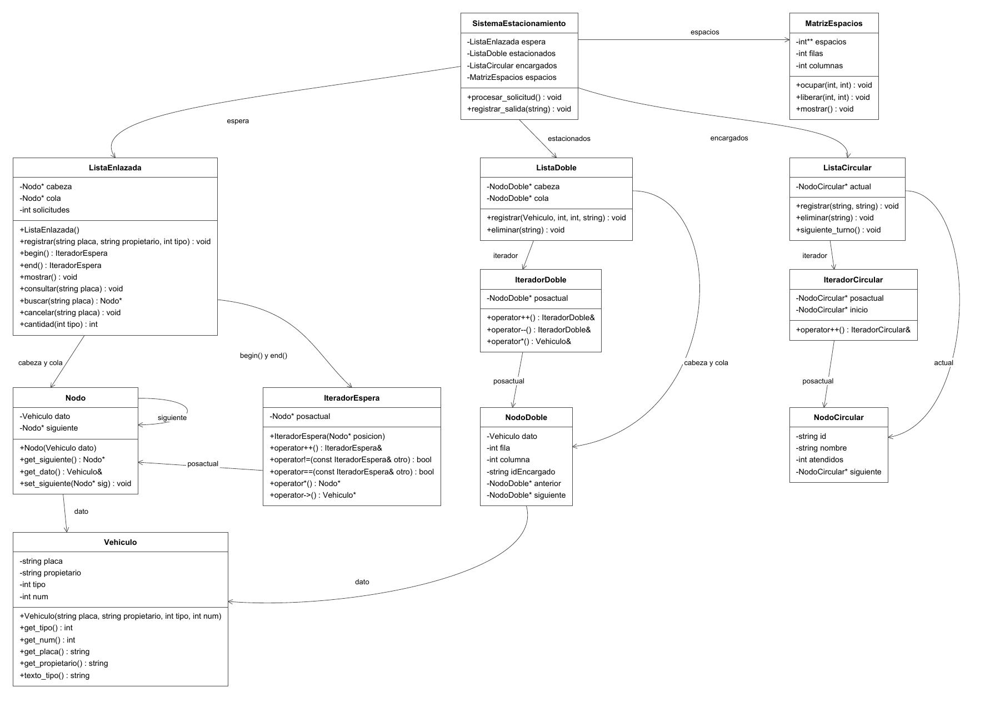

# Documento técnico de la Tarea 2

Programación II (CI0113)

Paola Espinoza Hernández (C32715) y Sebastián Miranda Ramírez (C4H274)

El programa registra las solicitudes de ingreso y las salidas de vehículos de un estacionamiento. Las solicitudes se atienden en orden de llegada y los encargados se turnan para recibir cada vehículo.

## Diagrama de clases



El diagrama corresponde al primer avance. Algunos de los nombres finales cambiaron ligeramente, se describen a continuación:

## Clases

| Clase | Función |
| --- | --- |
| `Sistema` | Maneja el menú, coordina los ingresos y las salidas y lleva el total recaudado. |
| `Vehiculo` | Guarda la placa, el propietario, el tipo de vehículo y el número de solicitud. |
| `ListaEnlazada` | Guarda las solicitudes pendientes en el orden en que se registran. |
| `Estacionado` | Guarda el vehículo, la fila y la columna asignadas y el ID del encargado. |
| `ListaDoble` | Guarda los vehículos estacionados y permite recorrerlos en ambos sentidos. |
| `Encargado` | Guarda el ID, el nombre y la cantidad de vehículos atendidos. |
| `ListaCircular` | Guarda a los encargados y lleva el turno del próximo ingreso. |
| `Matriz` | Guarda el estado de cada espacio. 0 indica que está libre y 1 indica ocupado. |

## Pruebas

Las 12 pruebas de `pruebas.cpp` pasaron. Se probaron las solicitudes, el recorrido y la eliminación en la lista doble, los límites y la ocupación de la matriz, y el cambio de turno al asignar vehículos o eliminar encargados.

### Prueba desde el menú

Se registró el ingreso del carro `A` y su salida una hora después. El programa cobró 900 colones y liberó el espacio.

```text
CONFIGURACIÓN INICIAL
Ingrese cantidad de filas: 1
Ingrese cantidad de columnas: 1
Estacionamiento creado correctamente.
Espacios disponibles: 1

=========================================
 SISTEMA DE ESTACIONAMIENTO
=========================================
1. Gestionar solicitudes de ingreso
2. Procesar siguiente solicitud
3. Consultar vehículos estacionados
4. Registrar salida de vehículo
5. Gestionar encargados
6. Mostrar matriz del estacionamiento
7. Generar reportes
0. Salir
Seleccione una opción: 5

GESTIÓN DE ENCARGADOS
1. Registrar encargado
2. Eliminar encargado
3. Consultar siguiente encargado
4. Avanzar turno
5. Mostrar encargados
6. Mostrar orden de rotación
0. Volver
Seleccione una opción: 1
ID: E01
Nombre: Ana
Encargados registrados: 1

GESTIÓN DE ENCARGADOS
1. Registrar encargado
2. Eliminar encargado
3. Consultar siguiente encargado
4. Avanzar turno
5. Mostrar encargados
6. Mostrar orden de rotación
0. Volver
Seleccione una opción: 0

=========================================
 SISTEMA DE ESTACIONAMIENTO
=========================================
1. Gestionar solicitudes de ingreso
2. Procesar siguiente solicitud
3. Consultar vehículos estacionados
4. Registrar salida de vehículo
5. Gestionar encargados
6. Mostrar matriz del estacionamiento
7. Generar reportes
0. Salir
Seleccione una opción: 1

GESTIÓN DE SOLICITUDES
1. Registrar solicitud
2. Mostrar solicitudes pendientes
3. Consultar solicitud por placa
4. Cancelar solicitud
5. Cantidad de solicitudes pendientes
0. Volver
Seleccione una opción: 1
Placa: A
Propietario: Carlos
Tipo (0 = Automóvil, 1 = Motocicleta): 0
Solicitud 1 registrada correctamente.

GESTIÓN DE SOLICITUDES
1. Registrar solicitud
2. Mostrar solicitudes pendientes
3. Consultar solicitud por placa
4. Cancelar solicitud
5. Cantidad de solicitudes pendientes
0. Volver
Seleccione una opción: 0

=========================================
 SISTEMA DE ESTACIONAMIENTO
=========================================
1. Gestionar solicitudes de ingreso
2. Procesar siguiente solicitud
3. Consultar vehículos estacionados
4. Registrar salida de vehículo
5. Gestionar encargados
6. Mostrar matriz del estacionamiento
7. Generar reportes
0. Salir
Seleccione una opción: 2
Solicitud: 1 - A
Espacio asignado: Fila 1, Columna 1
Encargado: Ana
Ingreso registrado correctamente.
Siguiente encargado: Ana

=========================================
 SISTEMA DE ESTACIONAMIENTO
=========================================
1. Gestionar solicitudes de ingreso
2. Procesar siguiente solicitud
3. Consultar vehículos estacionados
4. Registrar salida de vehículo
5. Gestionar encargados
6. Mostrar matriz del estacionamiento
7. Generar reportes
0. Salir
Seleccione una opción: 4
Placa: A
Propietario: Carlos
Tipo: Automóvil
Horas de permanencia: 1
COMPROBANTE DE SALIDA
Placa: A
Horas de permanencia: 1
Tarifa por hora: 900 colones
Monto a pagar: 900 colones
Espacio (1,1) liberado.
Vehículo retirado del registro.

=========================================
 SISTEMA DE ESTACIONAMIENTO
=========================================
1. Gestionar solicitudes de ingreso
2. Procesar siguiente solicitud
3. Consultar vehículos estacionados
4. Registrar salida de vehículo
5. Gestionar encargados
6. Mostrar matriz del estacionamiento
7. Generar reportes
0. Salir
Seleccione una opción: 0
Memoria liberada. Programa finalizado.
```

## Diseño

`Sistema` comprueba que haya una solicitud, espacio libre y un encargado antes de registrar un ingreso. Para una salida, calcula el cobro antes de liberar el espacio y retirar el vehículo de la lista.

En la lista circular, el último nodo apunta al primero. El puntero `turno` indica quién recibe el próximo vehículo. Si se elimina al encargado en turno, el turno pasa a su siguiente.
