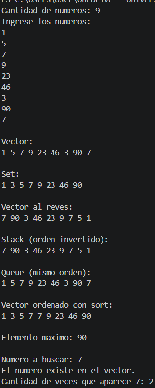

# Tarea STL
Paola Espinoza Hernández, Sebastián Miranda

## Parte 1

1. La STL significa Standard Template Library, o Biblioteca Estándar de Plantillas. Es un conjunto de estructuras de datos, iteradores y algoritmos que forman parte de la biblioteca estándar de C++. La idea es poder usar una lista o buscar y ordenar datos sin tener que programar todo desde cero. Por ejemplo, en clase hicimos los nodos y los enlaces de una lista doble; con `std::list` esa implementación ya viene hecha. Se basa en plantillas, así que una misma estructura puede trabajar con distintos tipos de datos. La desarrollaron principalmente Alexander Stepanov y Meng Lee en HP Labs, a principios de los años noventa. En 1994 el comité de C++ aceptó incorporarla al borrador del estándar y quedó incluida en C++98, publicado en 1998.


2. **Contenedor:** Un clase que puede contener y administrar objetos de otro tipo. Existen los contenedores secuenciales (que tienen orden) y los asociativos (con llaves).
**Iterador:** Generalización de punteros, que permiten recorrer contenedores de manera uniforme. Existen los de acceso aleatorio, bidireccionales, hacia adelante y de entrada y salida.
**Algoritmo:** Los algoritmos de STL son algoritmos implementados de manera genérica, capaces de recorrer los contenedores realizados por los usuarios. Los usuraios también pueden realizar algoritmos genéricos. Se agrupan en 4 grupos: los que cambian el orden de los elementos en el contenedor, los que no, los de ordenamiento y operaciones similares, y los de operaciones numéricas.

3. No hay que instalarla aparte; normalmente ya viene con el compilador y su biblioteca estándar de C++. Para usarla incluimos el encabezado que necesitamos, igual que hacemos con `<iostream>`. Los encabezados llevan el mismo nombre que cada contenedor o adaptador: `<vector>`, `<deque>`, `<list>`, `<array>`, `<set>`, `<stack>` y `<queue>`. Por ejemplo, con `#include <vector>` ya podemos declarar un `std::vector<int>`. Para algoritmos como `find`, `count` o `sort`, incluimos `<algorithm>`.

4. `std` es el espacio de nombres de la biblioteca estándar de C++. Podemos verlo como un grupo donde están nombres como `vector`, `list` y `cout`, para distinguirlos de otros que usemos en el programa. Por eso `std::vector` indica que queremos el `vector` que está dentro de `std`, igual que pasa con `std::cout`. Cuando ponemos `using namespace std;`, podemos usar esos nombres sin escribir `std::` cada vez.

5. Incluye casi todas las librerías estándar de C y C++. No se recomienda utilizarlo porque carga librerías que no se van a utilizar, lo que puede aumentar el tiempo de compilación. Además, podría causar coalisión con los nombres reservados de las librerías.

## Parte 2
Un contenedor es un objeto que puede guardar y administrar objetos de otros tipos. Los contenedores secuenciales, como su nombre lo indica, son contenedores donde sus elementos tienen un orden lineal. Por su lado, en los contenedores asociativos, los elementos se organizan mediante llaves, que pueden ser únicas o múltiples.

### 1. Vector (`std::vector`)

#### 1. Funcionamiento Interno

Utiliza un arreglo dinámico contiguo en memoria. Si el arreglo se llena, el contenedor asigna internamente un bloque de memoria contiguo más grande (usualmente duplicando la capacidad anterior), copia o mueve todos los elementos al nuevo bloque, libera el bloque viejo y añade el nuevo elemento.

#### 2. Funciones Principales

1. `push_back(val)`: Añade un elemento al final del vector.
2. `pop_back()`: Elimina el último elemento del vector.
3. `size()`: Retorna el número actual de elementos almacenados.
4. `capacity()`: Retorna el número total de elementos que puede almacenar antes de requerir una reasignación de memoria.
5. `reserve(n)`: Preasigna memoria para poder almacenar al menos $n$ elementos (evita copias innecesarias si ya se sabe la cantidad de elementos).
6. `at(idx)`: Acceso seguro al elemento en el índice `idx` (lanza una excepción si está fuera de rango).
7. `clear()`: Elimina todos los elementos del vector (dejando el tamaño en 0).
8. `empty()`: Retorna `true` si el vector no tiene elementos, `false` en caso contrario.

#### 3. Ejemplo Mínimo y Salida Esperada

```cpp
#include <iostream>
#include <vector>

int main() {
    std::vector<int> v;
    v.reserve(3); // Reserva capacidad
    v.push_back(10);
    v.push_back(20);
    v.push_back(30);

    std::cout << "Tamaño: " << v.size() << ", Capacidad: " << v.capacity() << "\n";
    std::cout << "Elemento en indice 1: " << v.at(1) << "\n";

    v.pop_back();
    std::cout << "Nuevo tamaño tras pop_back: " << v.size() << "\n";
}
```

**Salida esperada:**

```text
Tamaño: 3, Capacidad: 3
Elemento en indice 1: 20
Nuevo tamaño tras pop_back: 2
```

#### 4. Cuándo usarlo y cuándo no

- **Cuándo es la mejor opción:** Cuando se necesita acceso aleatorio rápido por índice (`O(1)`) y la mayoría de las inserciones ocurren al final del contenedor.
- **Cuándo es mala idea:** Cuando se realizan inserciones o eliminaciones frecuentes al inicio o en el medio, puesto que requiere desplazar todos los elementos subsecuentes (`O(N)`).


### 2. Deque (`std::deque`)

#### 1. Funcionamiento Interno

Un `deque` (double-ended queue) utiliza una estructura de bloques de memoria múltiples y separados, gestionados mediante un arreglo central de punteros a dichos bloques. Esto permite un crecimiento eficiente por ambos extremos sin requerir mover todos los elementos contiguos.

Mientras que `vector` almacena sus elementos en un único bloque de memoria contigua y crece de forma eficiente por el final, `deque` utiliza múltiples bloques de memoria discontinuos conectados por un arreglo de índices. Así, como para insertar en los extremos no necesita desplazar los elementos existentes en la memoria, sino que asigna o enlaza un nuevo bloque (o ranura) sin alterar la posición del resto de bloques de datos, puede insertar rápidamente tanto al inicio como al final.

#### 2. Funciones Principales

1. `push_back(val)`: Inserta un elemento al final del deque.
2. `push_front(val)`: Inserta un elemento al inicio del deque de manera eficiente.
3. `pop_back()`: Elimina el elemento del final.
4. `pop_front()`: Elimina el elemento del inicio.
5. `operator[]`: Acceso aleatorio al elemento en un índice dado.
6. `size()`: Retorna la cantidad de elementos.
7. `empty()`: Comprueba si el contenedor está vacío.
8. `clear()`: Limpia todos los elementos.

#### 3. Ejemplo Mínimo y Salida Esperada

```cpp
#include <iostream>
#include <deque>

int main() {
    std::deque<int> dq = {20, 30};
    dq.push_front(10); // Inserta al inicio
    dq.push_back(40);  // Inserta al final

    std::cout << "Primer elemento: " << dq.front() << "\n";
    std::cout << "Ultimo elemento: " << dq.back() << "\n";
    std::cout << "Elemento en indice 2: " << dq[2] << "\n";

    return 0;
}
```

**Salida esperada:**

```text
Primer elemento: 10
Ultimo elemento: 40
Elemento en indice 2: 30
```

#### 4. Cuándo usarlo y cuándo no

- **Cuándo es la mejor opción:** Cuando se requiere inserción y eliminación eficiente tanto al principio como al final, manteniendo acceso aleatorio por índice.
- **Cuándo es mala idea:** Cuando se necesita almacenamiento en memoria contigua. Por ejemplo, con APIs de C, porque estos esperan memoria completamente contigua (como punteros `T*`).


### 3. List (`std::list`)

#### 1. Funcionamiento Interno

Implementa una lista doblemente enlazada. Cada elemento (nodo) contiene el dato y dos punteros: uno que apunta al nodo siguiente y otro que apunta al nodo anterior.

Dado que los nodos están enlazados mediante punteros, insertar o eliminar un elemento en medio requiere únicamente actualizar los punteros de los nodos adyacentes, sin necesidad de mover ningún otro elemento de memoria.

#### 2. Funciones Principales

1. `push_back(val)`: Agrega un elemento al final.
2. `push_front(val)`: Agrega un elemento al inicio.
3. `insert(it, val)`: Inserta un elemento en la posición apuntada por el iterador `it`.
4. `erase(it)`: Elimina el elemento en la posición del iterador `it`.
5. `size()`: Retorna la cantidad de elementos.
6. `empty()`: Verifica si está vacía.
7. `remove(val)`: Elimina todos los elementos que coincidan con un valor específico.
8. `sort()`: Ordena los elementos de la lista internamente.

No tiene `operator[]`: Como no está almacenada en memoria contigua, acceder al elemento `N` requiere recorrer desde el inicio (o final) nodo por nodo en tiempo `O(N)`, la implementación de `operator[]` en esta estructura rompería la expectativa de eficiencia en tiempo constante que tiene un operador de índice.

#### 3. Ejemplo Mínimo y Salida Esperada

```cpp
#include <iostream>
#include <list>

int main() {
    std::list<int> l = {1, 3};

    auto it = l.begin();
    ++it; // Apunta al 3
    l.insert(it, 2); // Inserta el 2 antes del 3

    l.push_front(0);

    for (int n : l) {
        std::cout << n << " ";
    }

    std::cout << "\n";
    return 0;
}
```

**Salida esperada:**

```text
0 1 2 3
```

#### 4. Cuándo usarlo y cuándo no

- **Cuándo es la mejor opción:** Cuando se realizan inserciones y eliminaciones al inicio, final y en medio de la lista. Cuando se realizan inserciones y eliminaciones en medio de la secuencia sabiendo la posición exacta (iterador), como el ejemplo (es `O(1)` una vez ubicado el nodo). 
- **Cuándo es mala idea:** Cuando se requiere acceso aleatorio por índice (`[]`), pues se debe recorrer la lista nodo por nodo en tiempo lineal `O(N)`.


### 4. Array (`std::array`)

#### 1. Funcionamiento Interno

Un arreglo estático de tamaño fijo envuelto en una clase de C++.El almacenamiento es parte del objeto y su tamaño no puede cambiar después de su declaración.

Se diferencia de un arreglo tradicional porque soporta iteradores de la STL, y permite operaciones seguras como asignaciones directas entre objetos `array` completos (ej. `arr1 = arr2;`), conoce su propio tamaño mediante `.size()` y no decae implícitamente a un puntero (pointer decay al pasarlo a funciones).

#### 2. Funciones Principales

1. `at(idx)`: Acceso verificado por límites al índice `idx`.
2. `operator[]`: Acceso directo al índice `idx` sin verificación de límites.
3. `front()`: Retorna una referencia al primer elemento.
4. `back()`: Retorna una referencia al último elemento.
5. `size()`: Retorna el tamaño del arreglo (siempre el mismo valor fijo).
6. `empty()`: Retorna `true` si el tamaño configurado es 0.
7. `fill(val)`: Rellena todo el arreglo con un valor específico.
8. `data()`: Retorna un puntero directo al inicio de los datos subyacentes.

#### 3. Ejemplo Mínimo y Salida Esperada

```cpp
#include <iostream>
#include <array>

int main() {
    std::array<int, 3> arr = {5, 10, 15};
    arr.fill(7); // Rellena todo con 7

    std::cout << "Tamaño: " << arr.size() << "\n";
    std::cout << "Elemento 0: " << arr[0] << ", Elemento 2: " << arr.at(2) << "\n";

    return 0;
}
```

**Salida esperada:**

```text
Tamaño: 3
Elemento 0: 7, Elemento 2: 7
```

#### 4. Cuándo usarlo y cuándo no

- **Cuándo es la mejor opción:** Cuando se utilizaría un arreglo nativo (tamaño de la colección es pequeño y es conocido en tiempo de compilación) pero se busca la máxima eficiencia de memoria y rendimiento, y acceso a la STL.
- **Cuándo es mala idea:** Cuando los datos necesitan cambiar de tamaño dinámicamente o la cantidad de elementos es desconocida de antemano.

### 5. Set (`std::set`)

#### 1. Funcionamiento Interno

Implementado típicamente como un árbol binario de búsqueda auto-balanceado. Almacena elementos únicos y ordenados según un criterio de ordenamiento interno.

Al insertar nuevos elementos, se recorre la estructura y se inserta según sus reglas de comparación, de modo que los elementos siempre se mantienen ordenados. Además, si se intenta insertar un valor repetido, el `set` evita duplicarlo y no inserta ningún elemento. 

#### 2. Funciones Principales

1. `insert(val)`: Inserta un elemento manteniendo el orden y la unicidad.
2. `erase(val)`: Elimina un elemento por su valor.
3. `find(val)`: Busca un elemento y retorna un iterador apuntando a él (o `end()` si no existe).
4. `count(val)`: Retorna `1` si el elemento está presente o `0` si no lo está.
5. `size()`: Retorna la cantidad de elementos almacenados.
6. `empty()`: Comprueba si el set está vacío.
7. `clear()`: Elimina todos los elementos.
8. `begin()` / `end()`: Iteradores al inicio y final para recorrer el set ordenadamente.

#### 3. Ejemplo Mínimo y Salida Esperada

```cpp
#include <iostream>
#include <set>

int main() {
    std::set<int> s;

    s.insert(30);
    s.insert(10);
    s.insert(20);
    s.insert(10); // Elemento duplicado, se ignora

    std::cout << "Elementos ordenados: ";

    for (int n : s) {
        std::cout << n << " ";
    }

    std::cout << "\nBusqueda de 20: "
              << (s.find(20) != s.end() ? "Encontrado" : "No encontrado")
              << "\n";

    return 0;
}
```

**Salida esperada:**

```text
Elementos ordenados: 10 20 30
Busqueda de 20: Encontrado
```

#### 4. Cuándo usarlo y cuándo no

- **Cuándo es la mejor opción:** Cuando se necesita garantizar que no existan elementos duplicados y que los datos permanezcan ordenados.
- **Cuándo es mala idea:** Cuando se quiere conservar el orden de inserción. Cuando se necesita acceso rápido por índice numérico posicional. Cuando el rendimiento de inserción importa más que el orden (`std::unordered_set`).


# Tabla Comparativa Final

| Contenedor | Estructura interna | Acceso por índice | Insertar al final | Insertar al inicio | Insertar en medio | Buscar un elemento |
|------------|-------------------|-------------------|-------------------|-------------------|-------------------|-------------------|
| **vector** | Arreglo dinámico en memoria contigua; crece solo cuando se llena | Sí, con `v[i]` o `v.at(i)` | Sí, con `push_back(x)` | Sí, con `insert(v.begin(), x)`, pero tiene que correr todos los elementos; no existe `push_front` | Sí, con `insert(it, x)`; corre los elementos que están después | Sí, pero no tiene `find` propio; se usa `std::find` de `<algorithm>` |
| **deque** | Bloques de memoria múltiples y separados, gestionados por un arreglo central | Sí, `dq[i]` o `dq.at(i)` | Sí, `push_back(x)` | Sí, `push_front(x)` | Sí, `insert(it, x)`, desplazando elementos hacia el bloque más cercano | Sí, `std::find` de `<algorithm>` |
| **list** | Lista doblemente enlazada con nodos y punteros | No | Sí, con `push_back(x)` | Sí, `push_front(x)` | Sí, `insert(it, x)` | Sí, `std::find` o `remove` (para borrado por valor) |
| **array** | Arreglo estático de tamaño fijo en memoria contigua | Sí, `arr[i]` o `arr.at(i)` | No | No | No | Sí, `std::find` de `<algorithm>` |
| **set** | Árbol binario de búsqueda auto-balanceado (ej. Árbol rojo-negro) | No | No aplica (se inserta ordenado automáticamente) | No aplica (se inserta ordenado automáticamente) | No aplica (se inserta ordenado automáticamente) | Sí, `.find(x)` o `.count(x)` en tiempo `O(log N)` |

## Parte 3

### 1. ¿Qué es un adaptador de contenedor? ¿Por qué se dice que `stack` y `queue` no son contenedores "completos"?

Un adaptador de contenedor es una clase de la STL que utiliza un contenedor existente (como `deque`, `vector` o `list`) para almacenar datos, pero expone únicamente una interfaz específica. Su objetivo es restringir las operaciones disponibles para implementar un comportamiento determinado y cumplir las políticas LIFO o FIFO.

No son contenedores completos porque no tienen iteradores ni acceso aleatorio, no permiten recorrer los elementos y restringen el acceso a ciertos elementos, como la cima o los extremos.


### 2. ¿Qué contenedor usan por defecto `stack` y `queue` por dentro? ¿Se puede cambiar?

Por defecto, ambos usan `std::deque`. Sin embargo, este contenedor puede cambiare utilizando el segundo parámetro del template, que permite indicar otro contenedor compatible.

Por ejemplo, un stack que utiliza `vector` internamente:

```cpp
#include <stack>
#include <vector>

std::stack<int, std::vector<int>> miStackVector;
```


### 3. Explique las políticas LIFO y FIFO con un ejemplo de la vida real

#### LIFO (Last In, First Out)

**Último en entrar, primero en salir:** El último elemento agregado es el primero que se elimina.

**Ejemplo:** una pila de platos. Los platos se apilan uno encima de otro, y se empieza lavando el que se encuentra más ariba, es decir, el que se puso de último.

#### FIFO (First In, First Out)

**Primero en entrar, primero en salir:** El primer elemento agregado es el primero que se elimina.

**Ejemplo:** una fila en un supermercado. Las personas son atendidas en su orden de llegada, de modo que el primero en la fila es el primero en pagar.

### 4. Funciones principales de cada adaptador

#### `std::stack`

1. `push(valor)`: Inserta un elemento en la cima.
2. `pop()`: Elimina el elemento que está en la cima.
3. `top()`: Devuelve una referencia al elemento ubicado en la cima.
4. `size()`: Retorna la cantidad de elementos almacenados.
5. `empty()`: Retorna `true` si el stack está vacío.
6. `emplace(args...)`: Construye un elemento directamente en la cima.

#### `std::queue`

1. `push(valor)`: Inserta un elemento al final de la cola.
2. `pop()`: Elimina el elemento que se encuentra al frente.
3. `front()`: Devuelve una referencia al elemento del frente.
4. `back()`: Devuelve una referencia al último elemento de la cola.
5. `size()`: Retorna la cantidad de elementos almacenados.
6. `empty()`: Retorna `true` si la cola está vacía.
7. `emplace(args...)`: Construye un elemento directamente al final de la cola.

### 5. ¿Por qué `pop()` no devuelve el elemento eliminado?

La interfaz separa la consulta del elemento y su eliminación, puesto que si `pop()` devolviera el elemento y ocurriera una excepción durante la copia o movimiento del valor, el elemento podría perderse.

Por eso se debe obtener primero el dato y luego eliminarlo:

```cpp
int valor = s.top();
s.pop();
```

o para una cola:

```cpp
std::string nombre = q.front();
q.pop();
```

### 6. ¿Por qué estos adaptadores no tienen iteradores?

Porque su objetivo es imponer una política de acceso restringida. Si existieran iteradores podrían recorrerse o modificarse elementos internos, rompiendo la filosofía LIFO y FIFO.

#### Implicaciones

No se puede hacer:

```cpp
for (int x : miStack)
{
    std::cout << x;
}
```

Tampoco:

```cpp
miStack.begin();
miStack.end();
```

Para recorrerlos es necesario extraer elementos:

```cpp
while (!s.empty())
{
    std::cout << s.top() << " ";
    s.pop();
}
```

Esto destruye el contenido original.

Si se desea conservarlo, se debe crear una copia y procesar la copia:

```cpp
std::stack<int> copia = s;
```

### 7. Ejemplo mínimo de `std::stack`

```cpp
#include <iostream>
#include <stack>

using namespace std;

int main()
{
    stack<int> s;

    s.push(10);
    s.push(20);
    s.push(30);

    cout << "Cima (top): " << s.top() << endl;
    cout << "Tamaño: " << s.size() << endl;

    cout << "Vaciando el stack (LIFO):" << endl;

    while (!s.empty())
    {
        cout << s.top() << " ";
        s.pop();
    }

    cout << endl;

    return 0;
}
```

#### Salida esperada

```text
Cima (top): 30
Tamaño: 3
Vaciando el stack (LIFO):
30 20 10
```

---

### 8. Ejemplo mínimo de `std::queue`

```cpp
#include <iostream>
#include <queue>
#include <string>

using namespace std;

int main()
{
    queue<string> q;

    q.push("Ana");
    q.push("Carlos");
    q.push("Elena");

    cout << "Frente (front): " << q.front() << endl;
    cout << "Final (back): " << q.back() << endl;

    cout << "Vaciando la queue (FIFO):" << endl;

    while (!q.empty())
    {
        cout << q.front() << " ";
        q.pop();
    }

    cout << endl;

    return 0;
}
```

#### Salida esperada

```text
Frente (front): Ana
Final (back): Elena
Vaciando la queue (FIFO):
Ana Carlos Elena
```


## Parte 4

### 1. ¿Qué es un iterador en la STL? ¿Qué operaciones básicas permite? ¿Cómo se compara con el de clase?

Un iterador en la STL es una abstracción y generalización de los punteros. Permite a un programa recorrer los elementos de distintas estructuras de datos (contenedores y rangos) de manera uniforme, sin necesidad de conocer los detalles internos de cómo están almacenados (seguidos o dispersos).
* **Operaciones básicas:** Las operaciones mínimas suelen ser para acceder al elemento (`*it`), avanzar (`++it`), comparar igualdad (`it == otro`) y desigualdad (`it != otro`). Sin embargo, dependiendo de su categoría (entrada, salida, forward, bidireccional o de acceso aleatorio), soportan operaciones como la desreferenciación (`*it` o `it->`), el incremento (`++it`, `it++`), el decremento (`--it`, `it--`), comparaciones de igualdad y desigualdad (`==`, `!=`), y aritmética de punteros (en iteradores de acceso aleatorio como `it + n`). 
* **Comparación con el de clase:** Si bien ambos encapsulan la posición actual dentro de una estructura de datos y sobrecargar operadores (`*`, `++`, `==`, `!=`), los iteradores de la STL se clasifican en categorías estandarizadas con diversas capacidades (input, output, forward, bidirectional y random access), de modo que cumplen varios requisitos que los de la clase no cumplen y se adaptan mejor. Además, suelen incluir tipos anidados requeridos por los *iterator traits* (como `iterator_category`, `value_type`, `difference_type`, `pointer`, `reference`), compatibilidad con adaptadores (como `std::reverse_iterator`), y soporte para versiones constantes (`const_iterator`).

### 2. ¿Qué devuelven `begin()` y `end()`? ¿Por qué `end()` apunta una posición después del último elemento?

Ambos devuelven un iterador, `begin()` devuelve un iterador que apunta al primer elemento del contenedor y `end()` devuelve un iterador que apunta a la posición inmediatamente posterior al último elemento. Esto porque facilita la lógica de los bucles (el bucle continúa mientras el iterador actual sea distinto de `end()`) y para detectar facilmente cuando un contenedor está vacío (ambos devuelven el mismo). Además, se destaca que por el estándar, aunque el `end()` apunta fuera del rango de la estructura y, por tanto, no se puede desreferenciar, es seguro comparar con este.

### 3. ¿Por qué `std::sort` funciona con `vector` pero no con `list`? ¿Qué hace `list` en su lugar?

`std::sort` requiere iteradores de acceso aleatorio (`LegacyRandomAccessIterator`) porque algoritmos eficientes como *Introsort* (la base de `std::sort`) necesitan iteradores de acceso aleatorio. Como `std::vector` almacena sus elementos en memoria contigua, lo permite; en cambio, un `std::list` está implementado como una lista doblemente enlazada con iteradores bidireccionales (`LegacyBidirectionalIterator`), por lo que avanzar $N$ posiciones toma tiempo lineal $O(N)$ y no se puede acceder directamente al elemento medio.
* **¿Qué hace `list` en su lugar?:** `std::list` tiene su propia función optimizada para ordenar, `list::sort()`. Esta función reorganiza los nodos internamente reasignando los punteros de los enlaces (sin mover los datos de sitio) mediante un algoritmo de ordenamiento estable adecuado para listas (como *Merge Sort*).


### 4. ¿Cómo los algoritmos de `<algorithm>` trabajan sin conocer el contenedor? ¿Por qué son el "puente"?

Los algoritmos de `<algorithm>` trabajan sin conocer el contenedor usando plantillas. Las funciones de `<algorithm>` (como `std::find`, `std::count`, `std::sort`) no reciben contenedores enteros, sino pares de iteradores que delimitan un rango (`first`, `last`). El algoritmo solo interactúa con los elementos mediante las operaciones genéricas que soportan los iteradores (`*`, `++`, etc.).

Se consideran el "puente" porque actúan como una interfaz común, puesto que permiten que un mismo algoritmo funcione igual tanto para un `std::vector`, un `std::list`, un `std::set`, un arreglo nativo de C (`int arr[]`), o incluso un flujo de entrada/salida (`std::istream_iterator`), sin importar cómo estén estructurados o guardados los datos en la memoria.

### 5. ¿Qué significa que un iterador quede invalidado? Ejemplo con `vector` vs `list`.

Un iterador queda invalidado cuando se modifica la estructura del contenedor (añadiendo, eliminando o reubicando elementos) de forma que la dirección de memoria o la posición lógica a la que apuntaba un iterador deja de ser válida o pasa a apuntar a basura u otro elemento, provocando un comportamiento indefinido si se intenta usar.
* **Ejemplo con `std::vector`:** Si se tiene un vector lleno a su capacidad y se ejecuta un `push_back()`, el vector debe reasignar memoria en un bloque más grande, copiar todos sus elementos allí y liberar el bloque viejo, por lo que todos los iteradores existentes que apuntaban al vector original quedan invalidados.
* **Ejemplo con `list`:** Como los elementos están conectados entre ellos mediante punteros, al insertar o borrar un elemento, cambian solamente los punteros de los nodos adyacentes. Así, al eliminar un nodo, el iterador queda invalidado solamente si apuntaba a ese nodo, si apuntan a otra parte de la lista, se mantienen válidos. 

### 6. ¿Qué relación tiene el *for* de rango (`for (auto x : v)`) con `begin()` y `end()`? ¿Funcionaría con nuestra clase?

* **Relación con `begin()` y `end()`:** El bucle de rango (introducido en C++11) es traducido por el compilador a un bucle tradicional utilizando los iteradores del contenedor. 

Por tanto, funcionaría siempre y cuando se implementen en la clase las funciones `begin()` y `end()`, y estas retornen objetos que cumplan con los requisitos mínimos de un iterador (`*`, `++` y `!=`).


### 7. Diferencia entre `iterator`, `const_iterator` y `reverse_iterator`

* **`iterator`**: Permite leer y modificar los elementos del contenedor a través de la desreferenciación.
* *Ejemplo:*
```cpp
std::vector<int> v = {1, 2, 3};
std::vector<int>::iterator it = v.begin();
*it = 10;
std::cout << v[0];
```


* **`const_iterator`**: Es un iterador de solo lectura, permite leer los elementos pero no puede modificarlos.
* *Ejemplo:*
```cpp
std::vector<int> v = {1, 2, 3};
std::vector<int>::const_iterator cit = v.begin();
int val = *cit; // Lee el valor (val = 1).
// *cit = 20;   // Error de compilación. No se puede modificar un elemento a través de un const_iterator.
std::cout << val;
```


* **`reverse_iterator`**: Invierte la dirección del recorrido. Al incrementarlo (`++`), el iterador se mueve físicamente hacia **atrás** en el contenedor (hacia el inicio). Se obtiene típicamente mediante `rbegin()` y `rend()`.
* *Ejemplo:*
```cpp
std::vector<int> v = {1, 2, 3};
std::vector<int>::reverse_iterator rit = v.rbegin();
// *rit apunta al último elemento (3).
// Al hacer ++rit, se mueve hacia atrás, apuntando al número 2.
for (; rit != v.rend(); ++rit) {
    std::cout << *rit << " ";
}
std::cout << std::endl;
```


## Parte 5




cppreference.com. (s. f.). Containers library. cppreference.com. https://en.cppreference.com/cpp/container
cppreference.com. (s. f.). Iterator library. cppreference.com. https://en.cppreference.com/cpp/iterator
cppreference.com. (s. f.). std::stack. cppreference.com. https://en.cppreference.com/cpp/container/stack
cppreference.com. (s. f.). std::queue. cppreference.com. https://en.cppreference.com/cpp/container/queue
Weidl, J. (1996, abril 26). The standard template library tutorial. Information Systems Institute, Distributed Systems Department, Technical University Vienna. https://pages.di.unipi.it/corradini/Didattica/AP-24/DOCS/stl-tutorial-Weidl.pdf

Stepanov, A. (s. f.). Short History of STL. https://www.stepanovpapers.com/history%20of%20STL.pdf
Musser, D. R., Derge, G. J. y Saini, A. (2001). STL Tutorial and Reference Guide: C++ Programming with the Standard Template Library (2.ª ed.). Addison-Wesley. https://www.informit.com/store/stl-tutorial-and-reference-guide-c-plus-plus-programming-9780201379235
GNU Project. (s. f.). Headers. The GNU C++ Library Manual. https://gcc.gnu.org/onlinedocs/libstdc++/manual/using_headers.html
Microsoft. (s. f.). Namespaces (C++). Microsoft Learn. https://learn.microsoft.com/en-us/cpp/cpp/namespaces-cpp
